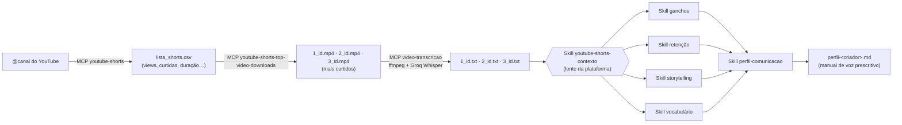

# Perfil de Comunicação de Influenciadores — YouTube Shorts

Pipeline que transforma os **YouTube Shorts de um criador** num **perfil de comunicação reutilizável**: um manual de voz em Markdown que você entrega a uma IA, junto com qualquer copy, para reescrevê-la no estilo daquele influenciador.

Tudo roda dentro do [Claude Code](https://claude.com/claude-code):

- **3 servidores MCP em Node.js** coletam os dados: lista de Shorts, download dos mais curtidos e transcrição.
- **6 Skills** analisam as transcrições e sintetizam o perfil.
- **Specs** em Markdown descrevem cada execução como um checklist auditável.



---

## Sumário

- [Por que este projeto existe](#por-que-este-projeto-existe)
- [Estrutura do repositório](#estrutura-do-repositório)
- [Requisitos](#requisitos)
- [Instalação](#instalação)
- [Como usar](#como-usar)
- [MCPs](#mcps)
- [Skills](#skills)
- [Specs e template](#specs-e-template)
- [Arquivos gerados](#arquivos-gerados)
- [Exemplo real: @fabriciopacholok](#exemplo-real-fabriciopacholok)
- [Limitações e cuidados](#limitações-e-cuidados)
- [Solução de problemas](#solução-de-problemas)
- [Histórico de prompts](#histórico-de-prompts)

---

## Por que este projeto existe

Escrever "no estilo de alguém" costuma virar imitação rasa: duas gírias e um emoji. Este projeto parte do material real (o que o criador **fala** nos vídeos que mais performam) e analisa quatro dimensões separadas:

| Dimensão | Pergunta que responde |
|---|---|
| **Ganchos** | Como ele prende a atenção nos primeiros ~3 segundos? |
| **Retenção** | O que faz a pessoa assistir até o fim, comentar e reassistir? |
| **Storytelling** | Como ele estrutura a história ou o argumento? |
| **Vocabulário** | Que palavras, bordões e construções tornam a fala dele reconhecível? |

Tudo é julgado pela **régua do Shorts** (feed vertical, scroll, loop, tom lo-fi, cultura de internet BR), e não pela de um texto formal. O resultado final é **prescritivo**, com regras imperativas ancoradas em citações literais, e **autossuficiente**: funciona colado numa conversa nova, sem acesso às transcrições.

---

## Estrutura do repositório

```
projeto-instagram/
├── .claude/
│   └── skills/                                   # Skills do Claude Code
│       ├── youtube-shorts-contexto/              # lente base + script que junta transcrições
│       │   ├── SKILL.md
│       │   └── scripts/juntar-transcricoes.js
│       ├── youtube-shorts-analise-ganchos/SKILL.md
│       ├── youtube-shorts-analise-retencao/SKILL.md
│       ├── youtube-shorts-analise-storytelling/SKILL.md
│       ├── youtube-shorts-analise-vocabulario/SKILL.md
│       └── youtube-shorts-analise-perfil-comunicacao/SKILL.md
├── .spec/                                        # execuções planejadas/registradas, uma por criador
│   ├── perfil-fabriciopacholok/spec.md
│   └── perfil-marcioatalla/spec.md
├── .mcp.json                                     # registro dos MCPs para o Claude Code
├── .gitignore
├── README.md
└── resources/
    ├── docs/                                     # diagramas (Excalidraw)
    │   ├── visao-geral.excalidraw
    │   └── mcp.excalidraw
    ├── mcps/                                     # servidores MCP (Node.js, stdio)
    │   ├── youtube-shorts/
    │   ├── youtube-shorts-top-video-downloads/
    │   └── video-transcricao/
    ├── prompts/                                  # prompts que geraram cada parte do projeto
    ├── templates/
    │   └── spec-perfil-influenciador.md          # modelo de spec para um novo criador
    └── shorts/                                   # dados por conta (gerados)
        └── <conta>/
            ├── lista_shorts.csv
            ├── <ordem>_<video_id>.mp4            # ignorado pelo git
            ├── <ordem>_<video_id>.txt
            ├── youtube-shorts-analise-*.md
            └── perfil-<conta>.md
```

---

## Requisitos

| Item | Versão / observação |
|---|---|
| **Node.js** | 18 ou superior (testado com 24) |
| **npm** | vem com o Node |
| **Claude Code** | CLI, app desktop ou extensão de IDE. Necessário para usar MCPs e Skills de forma integrada |
| **Chave da Groq** | gratuita em <https://console.groq.com/keys>. Usada só na transcrição |
| **ffmpeg** | **não precisa instalar**: vem pelo pacote `ffmpeg-static` no `npm install` |

Funciona em Windows, macOS e Linux.

---

## Instalação

```bash
git clone https://github.com/CarlosRobertoMedeiros/repo-ia.git
cd repo-ia/projects/projeto-instagram
```

Instale as dependências dos MCPs que usam `ffmpeg-static`. O `youtube-shorts` não tem dependências.

```bash
npm install --prefix resources/mcps/youtube-shorts-top-video-downloads
```

```bash
npm install --prefix resources/mcps/video-transcricao
```

Configure a chave da Groq:

```bash
cp resources/mcps/video-transcricao/.env.example resources/mcps/video-transcricao/.env
```

Edite `resources/mcps/video-transcricao/.env` e preencha `GROQ_API_KEY=gsk_...`. O `.env` está no `.gitignore` e **nunca** deve ser commitado.

Abra o Claude Code **na pasta `projeto-instagram`**. O arquivo `.mcp.json` registra os três MCPs automaticamente, e na primeira vez o Claude Code pede para você aprovar os servidores do projeto. As Skills em `.claude/skills/` também são detectadas sozinhas. Se você criar ou editar uma skill com a sessão aberta, rode `/reload-skills`.

---

## Como usar

### Opção 1: executar uma spec (recomendado)

Cada criador tem uma spec com o passo a passo completo. No Claude Code, peça:

```
execute a spec .spec\perfil-fabriciopacholok\spec.md e marque cada passo executado registrando as evidências de execução com data e hora
```

O Claude executa os MCPs e as Skills na ordem e marca cada tarefa com `[x]`, registrando data e hora, ferramenta usada e evidência (arquivos, tamanhos, retorno dos MCPs).

Para um criador novo, gere a spec a partir do template:

```
gere a spec do @<conta> a partir de resources/templates/spec-perfil-influenciador.md
```

### Opção 2: passo a passo manual

| # | O que pedir ao Claude Code | Ferramenta |
|---|---|---|
| 1 | "liste os shorts da conta @fabriciopacholok" | MCP `fetch_account_shorts` |
| 2 | "baixe os 3 shorts mais curtidos do fabriciopacholok" | MCP `download_top_shorts` |
| 3 | "transcreva os vídeos da pasta resources\shorts\fabriciopacholok" | MCP `transcrever_videos` |
| 4 | `/youtube-shorts-analise-ganchos resources\shorts\fabriciopacholok` | Skill |
| 5 | `/youtube-shorts-analise-retencao resources\shorts\fabriciopacholok` | Skill |
| 6 | `/youtube-shorts-analise-storytelling resources\shorts\fabriciopacholok` | Skill |
| 7 | `/youtube-shorts-analise-vocabulario resources\shorts\fabriciopacholok` | Skill |
| 8 | "gere o perfil de comunicação do fabriciopacholok com base nas análises" | Skill `youtube-shorts-analise-perfil-comunicacao` |

As Skills também disparam por linguagem natural ("analisa os ganchos…", "como ele fala?", "quais os bordões dele?", "monta o perfil de voz…") e aceitam **texto colado direto no prompt**, além de pastas.

### Opção 3: usar o perfil para escrever uma copy

Abra uma conversa nova com qualquer IA e cole:

```
<conteúdo de perfil-fabriciopacholok.md>

Reescreva a copy abaixo na voz desse criador, seguindo o perfil e o checklist da seção 8:

<sua copy>
```

### Uso dos MCPs sem o Claude Code

Os três servidores também funcionam direto pelo terminal:

```bash
node resources/mcps/youtube-shorts/server.js --username @fabriciopacholok
```

```bash
node resources/mcps/youtube-shorts-top-video-downloads/server.js --csv resources/shorts/fabriciopacholok/lista_shorts.csv --quantidade 3
```

```bash
node resources/mcps/video-transcricao/server.js --caminho resources/shorts/fabriciopacholok --idioma pt
```

---

## MCPs

Os três são servidores [MCP](https://modelcontextprotocol.io) em Node.js (ES modules, transporte stdio), registrados em `.mcp.json`. Cada pasta tem seu próprio `README.md` com detalhes de implementação.

### 1. `youtube-shorts`: lista os Shorts de um canal

| | |
|---|---|
| **Ferramenta** | `fetch_account_shorts(username, maxPages = 200)` |
| **Entrada** | `@handle`, handle, URL do canal ou ID `UC...` |
| **Saída** | `resources/shorts/<conta>/lista_shorts.csv` |
| **Dependências** | nenhuma |

- Usa só a API pública **InnerTube** (`/youtubei/v1`), a mesma do site e do app. Não usa login, cookies, chave de API, Playwright nem Puppeteer.
- Resolve o handle para o ID do canal e percorre a playlist de Shorts (`UUSH...`) página por página, até o fim.
- Busca views, curtidas, data e duração de cada short, 3 em paralelo.
- Quando o player pede verificação anti-bot, a coleta continua pela página de exibição. Nesse caso a data vem só com o dia.
- **Reexecução incremental:** shorts novos entram no topo, os existentes têm views e curtidas atualizadas, e os removidos são mantidos.
- **Colunas do CSV:** `video_id, titulo, url, publicado_em, duracao_segundos, visualizacoes, curtidas, canal, descricao, atualizado_em`.

### 2. `youtube-shorts-top-video-downloads`: baixa os mais curtidos

| | |
|---|---|
| **Ferramenta** | `download_top_shorts(csvPath, quantidade)` |
| **Entrada** | caminho do CSV, a pasta que o contém ou só o nome da conta |
| **Saída** | `<ordem>_<video_id>.mp4` na pasta da conta (o mais curtido é o `1_…`) |
| **Dependências** | `ffmpeg-static` |

- Ordena o CSV **por curtidas**. As views não contam.
- Resolve a URL do vídeo pelo endpoint público `youtubei/v1/player`, tentando os clientes Android VR, iOS e Android.
- Prefere o formato com áudio e vídeo juntos. Se vierem separados, junta os dois com o ffmpeg.
- Arquivos já baixados são mantidos. Um erro num vídeo não interrompe os demais.

### 3. `video-transcricao`: transcreve com Groq Whisper

| | |
|---|---|
| **Ferramenta** | `transcrever_videos(caminho, forcar = false, recursivo = false, idioma?)` |
| **Entrada** | um vídeo ou uma pasta |
| **Saída** | `<nome-do-vídeo>.txt` ao lado do vídeo, só com o texto falado |
| **Dependências** | `ffmpeg-static`, chave `GROQ_API_KEY` |

- Extrai só o áudio: mono, 16 kHz, filtro de voz, Opus a 24 kbit/s (cerca de 10 MB por hora de fala).
- Áudios acima do limite da Groq (25 MB) são **divididos nos silêncios**, e o fim de cada parte vai como contexto para a seguinte.
- Pula vídeos que já têm `.txt` (use `forcar` para refazer).
- Em caso de limite de taxa (429), espera e tenta de novo.
- O `.txt` é gravado de forma atômica, então nunca fica pela metade.
- **Configuração:** `resources/mcps/video-transcricao/.env` (modelo em [`.env.example`](resources/mcps/video-transcricao/.env.example)):

| Variável | Padrão | Uso |
|---|---|---|
| `GROQ_API_KEY` | — | **Obrigatória.** Chave `gsk_...` |
| `GROQ_BASE_URL` | `https://api.groq.com/openai/v1` | Endpoint (proxy/gateway) |
| `GROQ_TRANSCRIBE_MODEL` | `whisper-large-v3` | Ou `whisper-large-v3-turbo` |
| `TRANSCRICAO_IDIOMA` | detecção automática | `pt`, `en`, `es`… |
| `TRANSCRICAO_TEMPERATURA` | `0` | 0 = mais fiel ao áudio |
| `TRANSCRICAO_PROMPT` | — | Nomes próprios/termos para guiar a grafia |
| `TRANSCRICAO_AUDIO_KBPS` | `24` | Bitrate do áudio (12–64) |
| `TRANSCRICAO_LIMITE_MB` | `24` | Tamanho máximo de cada parte enviada |
| `TRANSCRICAO_MAX_SEGUNDOS` | `0` | Duração máxima de cada parte (0 = só o tamanho conta) |
| `TRANSCRICAO_TENTATIVAS` | `4` | Tentativas em falhas temporárias |

---

## Skills

As Skills ficam em `.claude/skills/` e seguem o formato do Claude Code: um `SKILL.md` com frontmatter `name`/`description` e um corpo com as instruções. A `description` traz os termos que disparam cada uma.

| Skill | Papel | Dispara com termos como | Saída padrão (entrada = pasta) |
|---|---|---|---|
| `youtube-shorts-contexto` | **Lente base.** Não analisa nada sozinha: explica como o Shorts distribui vídeos, a gramática de gancho/retenção/loop, o tom lo-fi e a cultura de internet BR, os limites de uma transcrição e o procedimento para montar o corpus | "como funciona o Shorts", "o que faz viralizar", "todas as análises" | — |
| `youtube-shorts-analise-ganchos` | Classifica a abertura (~3 s) de cada vídeo em 12 tipos, dá nota de força 1–5 e mapeia as fórmulas de abertura do criador | "ganchos", "hook", "aberturas", "primeiros segundos" | `analise-ganchos.md` |
| `youtube-shorts-analise-retencao` | Mapeia a curva de cada vídeo: lacunas, pattern interrupts, re-gancho, cliffhanger, gordura, gatilhos de comentário e fechamento/loop | "retenção", "ritmo", "cliffhanger", "loop", "CTA" | `analise-retencao.md` |
| `youtube-shorts-analise-storytelling` | Formato, estrutura, personagens, loops e payoffs, batidas emocionais, específico vs. abstrato. Extrai templates de roteiro | "storytelling", "narrativa", "arco", "roteiro" | `analise-storytelling.md` |
| `youtube-shorts-analise-vocabulario` | Bordões com contagem, gírias, jargão, inglês, tratamento, palavrões, oralidade e regionalismos. Monta um guia de voz | "vocabulário", "como ele fala", "bordões", "gírias" | `analise-vocabulario.md` |
| `youtube-shorts-analise-perfil-comunicacao` | **Síntese.** Consolida as 4 análises (ou faz as análises a partir das transcrições brutas) num perfil prescritivo e autossuficiente | "perfil de comunicação", "perfil de voz", "guia de estilo", "escrever como ele" | `perfil-comunicacao-<criador>.md` |

### Princípios comuns das análises

- **Corpus único:** quando a entrada é uma pasta, todas as transcrições viram um texto só, e o objetivo é o **padrão recorrente** do criador, não um vídeo isolado.
- **Evidência literal:** todo padrão vem com citação entre aspas e o número do vídeo (`(V3)`), com a frequência explícita (`2/3`).
- **Honestidade com a transcrição:**
  - A transcrição só tem o áudio. Texto na tela, cortes e imagem não aparecem.
  - Erros do Whisper são marcados com `[leitura provável]`, por exemplo "curto nordicul" [nordic curl].
  - Fala de terceiros (dublagem, convidados) é separada da voz do criador.
- **Estimativa de tempo:** o script calcula `palavras/s` cruzando a transcrição com a duração do CSV. Assim, os "primeiros 3 s" viram as primeiras ~3 × palavras/s palavras.
- **Regra de consistência no perfil:** traço em ≥50% dos vídeos (ou em ≥3) é **assinatura** e vira regra. Em 2 vídeos é **tendência**. Uma vez só é **acidente** e fica fora das regras.

### Script `juntar-transcricoes.js`

Junta os `.txt` de uma pasta num corpus com cabeçalho por vídeo. Quando encontra um `lista_shorts.csv`, cruza cada arquivo pelo `video_id` e adiciona título, duração, views, curtidas, data e palavras/s.

```bash
node .claude/skills/youtube-shorts-contexto/scripts/juntar-transcricoes.js resources/shorts/fabriciopacholok
```

```
### CORPUS: 3 transcrições de …\fabriciopacholok | 292 palavras | metadados do CSV cruzados por video_id ###

=== VÍDEO 1 | arquivo: 1_1L0VDzbiuYk.txt | título: Treino top e o Zanca dando xilique! … | duração: 33s | views: 922246 | curtidas: 64151 | … | palavras/s: 0.85 ===
Bora? Mais uma? …
```

Opções: `--recursivo` (inclui subpastas) e `--saida <arquivo>` (grava em arquivo em vez de imprimir). Arquivos `analise-*` e `_corpus*` são ignorados.

### Estrutura do perfil de comunicação

O arquivo final sempre segue este template fixo:

1. **Resumo da voz**: quem ele soa ser, em uma linha.
2. **Princípios da voz**: 5–8 regras imperativas, cada uma com *por quê* e *âncora* literal.
3. **Gancho / abertura**: fórmulas preenchíveis e "nunca abra com".
4. **Vocabulário e tom**: bordões, gírias, tratamento e a tabela ❌ *Não use* → ✅ *Use no lugar*.
5. **Estrutura narrativa**: esqueletos de roteiro, elenco, concretude, loops.
6. **Retenção e ritmo**: mecanismos, velocidade de fala, fechamento.
7. **Banco de exemplos literais**: citações agrupadas por função.
8. **Como aplicar a uma copy**: passo a passo e checklist de conformidade.

---

## Specs e template

As specs (`.spec/perfil-<conta>/spec.md`) descrevem a execução completa para um criador em duas fases:

- **Fase 1, obtenção dos dados:** listar shorts → baixar os 3 mais curtidos → transcrever.
- **Fase 2, análise:** ganchos → retenção → storytelling → vocabulário → perfil.

Ao executar uma spec, cada item é marcado `[x]` e recebe **data/hora, ferramenta e evidência**. A spec vira o log auditável da execução. Veja [`.spec/perfil-fabriciopacholok/spec.md`](.spec/perfil-fabriciopacholok/spec.md).

Para criar uma spec nova, copie [`resources/templates/spec-perfil-influenciador.md`](resources/templates/spec-perfil-influenciador.md) para `.spec/perfil-<conta>/spec.md` e troque `{{conta}}`. Preencha também a seção **Observações** com as particularidades do canal: idioma, cortes com convidados, vídeos sem fala.

---

## Arquivos gerados

Por conta, em `resources/shorts/<conta>/`:

| Arquivo | Gerado por | Vai para o git? |
|---|---|---|
| `lista_shorts.csv` | MCP `youtube-shorts` | sim |
| `<ordem>_<video_id>.mp4` | MCP `youtube-shorts-top-video-downloads` | **não** (`*.mp4` no `.gitignore`) |
| `<ordem>_<video_id>.txt` | MCP `video-transcricao` | sim |
| `youtube-shorts-analise-*.md` / `analise-*.md` | Skills de análise | sim |
| `perfil-<conta>.md` | Skill de perfil | sim |

O `.gitignore` também exclui `.env`, `node_modules/` e os corpus temporários (`_corpus*.txt`).

---

## Exemplo real: @fabriciopacholok

Execução completa registrada em [`.spec/perfil-fabriciopacholok/spec.md`](.spec/perfil-fabriciopacholok/spec.md):

- **Coleta:** 958 Shorts listados. Baixados e transcritos os 3 mais curtidos (64 mil, 58 mil e 56 mil curtidas).
- **Análises:** [ganchos](resources/shorts/fabriciopacholok/youtube-shorts-analise-gancho.md) · [retenção](resources/shorts/fabriciopacholok/youtube-shorts-analise-retencao.md) · [storytelling](resources/shorts/fabriciopacholok/youtube-shorts-analise-storytelling.md) · [vocabulário](resources/shorts/fabriciopacholok/youtube-shorts-analise-vocabulario.md).
- **Perfil:** [`perfil-fabriciopacholok.md`](resources/shorts/fabriciopacholok/perfil-fabriciopacholok.md)

Trecho do perfil gerado:

> **Em uma linha:** um parceiro de treino contando, ofegante e rindo, a vez que alguém acabou com ele na série.
>
> 3. **Escale com números.** *Por quê:* a contagem é o motor de retenção, e cada número é um mini-cliffhanger. *Âncora:* "Quando eu fechei a 10… 19… A hora que eu subi a 20" (V3)

Com apenas 3 vídeos, o perfil declara **confiança baixa**. Para um perfil robusto, baixe e transcreva de 10 a 20 Shorts.

---

## Limitações e cuidados

- **Termos de uso:** os MCPs usam endpoints públicos do YouTube sem autenticação, que podem mudar ou ser bloqueados (verificação anti-bot) a qualquer momento. Use com moderação, para estudo e análise. Baixar e redistribuir vídeos de terceiros pode violar os Termos de Serviço do YouTube e direitos autorais. Os `.mp4` ficam só na sua máquina e não vão para o git.
- **Só a fala é analisada:** muitos ganchos de Shorts são visuais ou ficam no texto na tela. As análises indicam quando a fala "não carrega o gancho" em vez de concluir que ele não existe.
- **Qualidade da transcrição:** nomes próprios, jargão e inglês podem sair distorcidos. Use `TRANSCRICAO_PROMPT` com os nomes do nicho para melhorar a grafia.
- **Amostra:** com menos de ~8 vídeos, as análises falam em *indícios*, não em *padrões*.
- **Views ≠ fala:** o desempenho depende também de visual, título e momento da publicação. As comparações de gancho × views são indicativas.
- **Segredos:** nunca commite o `.env`. Se uma chave vazar, revogue-a no console da Groq.

---

## Solução de problemas

| Sintoma | Causa provável | O que fazer |
|---|---|---|
| "GROQ_API_KEY não configurada" | `.env` ausente ou vazio | Copie o `.env.example` para `.env` e preencha a chave |
| Aviso de verificação anti-bot na listagem | O YouTube limitou o player | Os dados seguem pela página de exibição. Rode de novo mais tarde para completar as datas |
| Download falha em alguns vídeos | Formato indisponível nos clientes públicos | O MCP segue com os demais. Tente de novo depois |
| Erro 429 na transcrição | Limite de áudio por hora da Groq | O MCP espera e tenta de novo. Se passar de 5 min, rode depois (os já transcritos são pulados) |
| MCP não aparece no Claude Code | Sessão aberta fora da pasta do projeto ou servidor não aprovado | Abra o Claude Code em `projeto-instagram` e aprove os servidores do `.mcp.json` |
| Skill nova/editada não aparece | Cache de skills | Rode `/reload-skills` |

---

## Histórico de prompts

A pasta [`resources/prompts/`](resources/prompts/) guarda os prompts usados para construir cada parte do projeto com o Claude Code:

| Arquivo | Gerou |
|---|---|
| `1-mcp-lista-shorts-youtube.txt` | MCP `youtube-shorts` |
| `2-mcp-download-top-shorts.txt` | MCP `youtube-shorts-top-video-downloads` |
| `3-mcp-transcricao-top-youtube-shorts.txt` | MCP `video-transcricao` |
| `4-skills-youtube-shorts-analise.txt` | Skills de contexto e das 4 análises |
| `5-skills-youtube-shorts-perfil.txt` | Skill de perfil de comunicação |

Os diagramas em [`resources/docs/`](resources/docs/) (`visao-geral.excalidraw`, `mcp.excalidraw`) podem ser abertos em <https://excalidraw.com>.

---

## Licença

Projeto pessoal de estudo, sem licença de uso definida. Os `package.json` dos MCPs estão marcados como `UNLICENSED` e `private`. Se for abrir para contribuições, adicione um arquivo `LICENSE`, por exemplo MIT.
